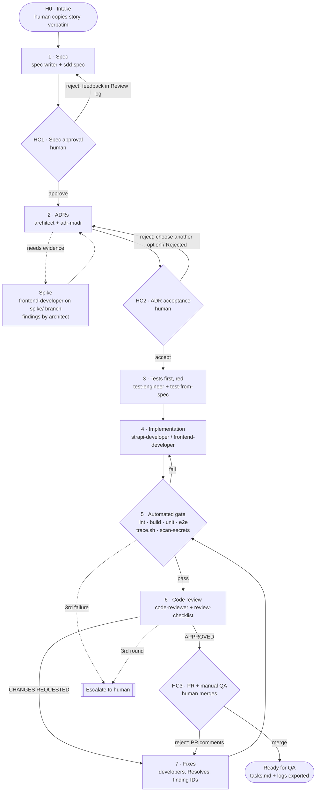

# FLOW — From functional user story to QA handoff

This document explains how a user story becomes a QA-ready increment in this repository: who
does what (AI agent or human), what each step produces, and where a person approves, rejects
or corrects the work.

The binding rules live in [CLAUDE.md](CLAUDE.md). The agent and skill catalogue is in
[AGENTS.md](AGENTS.md).

---

## 1. Design choices

### Tool: Claude Code

| Need | How Claude Code covers it |
|---|---|
| Subagents with separate responsibilities, versioned | `.claude/agents/*.md`: instructions, allowed and disallowed tools, model, preloaded skills, hooks |
| Reusable project knowledge, versioned | `.claude/skills/*/SKILL.md` with templates, loaded on demand |
| A global context file that governs generation | `CLAUDE.md`, loaded into every session and subagent |
| **Enforced** (not just requested) boundaries | `PreToolUse` hooks: per-agent write scopes, a project-wide Bash guard, and permission deny rules for `.env` |
| Unedited session logs | JSONL transcripts in `~/.claude/projects/…` plus `/export` |
| Git and GitHub from the same agent | Bash with `git` and `gh`, using a repo-local identity and credential helper |

Cursor, GitHub Copilot and Codex were alternatives. We did not run a feature-by-feature
verification of them, so we make no claims about what they lack. Claude Code was chosen because
it covers every row above in one tool, from versioned files, which we verified against its
official documentation. The deciding capability is **per-agent tool restrictions plus lifecycle
hooks**: they let a human *trust* the separation of responsibilities instead of hoping for it.

### Spec-Driven Development: our own lightweight variant

The spec is the source of truth. Tests are derived from it **before** the code, and the code
must make them pass. We did not adopt Spec Kit or Kiro, for three reasons:

- **Size.** Three stories do not justify their multi-phase scaffolding (constitution, plan and
  tasks generators).
- **Traceability.** We need IDs that run from the story to the PR (`US-01-AC-02`, …). With our
  own templates (`sdd-spec` skill), every artifact uses them and `scripts/trace.sh` can check
  them mechanically.
- **Gap detection.** The evaluation rewards specs that *detect gaps in the user story*, so our
  spec template has a first-class **Gaps and open questions** section, where each gap carries a
  proposed default and a human answer.

What we kept from SDD frameworks: spec → plan (ADRs + `tasks.md`) → tasks → implementation, with
a human approval between spec and implementation.

### Model allocation

| Role | Model | Why |
|---|---|---|
| Orchestrator (main session) | Claude Opus 5.5 | It holds the whole flow, talks to the human and routes the work |
| spec-writer, architect | Claude Opus 5.5 | Judgement-heavy work: finding gaps, weighing alternatives, verifying facts |
| test-engineer, strapi-developer, frontend-developer | Claude Sonnet 5.5 | Well-scoped work guided by an approved spec, ADRs and failing tests; faster and cheaper |
| code-reviewer | Claude Opus 5.5 | Deliberately a **different model from the implementers**, so the review does not share their blind spots |

---

## 2. Flow diagram



---

## 3. Step by step

| Step | Description | AI used? | AI, agent, subagent or skill used | Deliverable produced | Human in the loop |
|---|---|---|---|---|---|
| **0 · Flow setup** (once) | Repository, identity, agents, skills, hooks, scripts. Third-party skills are evaluated before adoption. | Yes | Claude Code, Opus 5.5 (main session) | `CLAUDE.md`, `AGENTS.md`, `FLOW.md`, `.claude/**`, `scripts/**`, `docs/skills/third-party-evaluation.md` | The human approves the proposal, each third-party skill (recorded decision) and the naming convention before anything is written. |
| **H0 · Intake** | The story is copied **verbatim** from the assessment, so the agents start from the real input and not from a paraphrase. | **No** by default. For US-01..03: **yes**, by human decision (see below) | Default: none. US-01..03: orchestrator (Opus 5.5) transcription + a deterministic word-by-word check against the PDF (`scripts/check-story-fidelity.py`) | `specs/US-NN/story.md` (with a provenance header: source, SHA-256, pages) | Default: the human writes it. US-01..03: the human delegated the transcription, and the fidelity check (0 differences) replaces the human copy. |
| **1 · Spec** | The story is turned into a verifiable spec. Rules are refined, gaps are listed with proposed defaults, ACs are written in Gherkin with IDs, and architectural decisions are flagged. | Yes | `spec-writer` (Opus 5.5) + skill `sdd-spec` | `specs/US-NN/spec.md`, `specs/US-NN/tasks.md` | — (next step is the gate) |
| **HC1 · Spec approval** | Nothing gets built on top of an unverified understanding. | **No** | — | Spec *Review log* row, *Human answer* cells, status `Approved` | **Human** answers the gaps and approves or rejects. **Approve if:** every BR is covered by an AC; every AC is testable with concrete values; every gap has an answer; scope and out-of-scope are explicit; no contradiction with accepted ADRs. **On rejection:** the feedback goes into the Review log and `spec-writer` revises it (same IDs, new version). |
| **2 · ADRs** | Decisions flagged by the spec are recorded with ≥2 real options and consequences. Library facts are verified against official sources or packages. When facts are not enough, a **spike** (30–60 min, throwaway branch) produces evidence. | Yes | `architect` (Opus 5.5) + skills `adr-madr`, `strapi-content-modeling`. Spikes: `frontend-developer` (Sonnet 5.5) | `adr/NNNN-*.md` (Proposed), `adr/README.md`, `docs/spikes/SPIKE-NN-*.md` | — (next step is the gate) |
| **HC2 · ADR acceptance** | Architecture is the most expensive thing to get wrong and the easiest for an agent to rationalise. | **No** | — | ADR status `Accepted` / `Rejected`, with *decision-makers* and date | **Human** reads the options and the strongest argument against the chosen one (the architect must state it). **Accept if:** the options are real, the drivers trace to requirements, the bad consequences have mitigations, and the facts are cited. **On rejection:** the human picks another option or marks it `Rejected` (the file is kept), and `architect` rewrites it. |
| **3 · Tests first** | Each AC becomes a test **before** the code exists, derived from the spec and not from an implementation. The tests must fail for the right reason. | Yes | `test-engineer` (Sonnet 5.5) + skills `test-from-spec`, `dynamic-form-fields` | `*.spec.ts`, `frontend/e2e/*.spec.ts`, `tasks.md` | Orchestrator check: `trace.sh` shows a test for every non-manual AC. No human gate here, because tests are reviewed again in step 6 and at HC3. |
| **4 · Implementation** | Production code that makes the tests pass, within the spec and ADRs. The write-scope hooks stop developers from editing tests or the spec. | Yes | `strapi-developer`, `frontend-developer` (Sonnet 5.5) + skills `strapi-content-modeling`, `dynamic-form-fields`, `angular-developer` (third-party, lower precedence) | `backend/**`, `frontend/**`, commits with `Refs:` | — |
| **5 · Automated gate** | Deterministic checks. Neither AI judgement nor human time is spent on what a script can verify. | **No** (scripts) | lint, `ng build`, Vitest, Playwright, `docker compose up`, `scripts/trace.sh`, `scripts/scan-secrets.sh` | Command output, summarised in `tasks.md` | **On failure:** back to step 4. **On the 3rd failure** of the same story: escalate to the human. |
| **6 · Code review** | An independent review against the spec, the ADRs and the checklist. The reviewer runs the checks itself and cannot modify code. | Yes | `code-reviewer` (Opus 5.5) + skill `review-checklist` | `reviews/US-NN-review-RN.md` (findings with IDs, severities, evidence) | — (findings are routed to step 7 or HC3) |
| **7 · Fixes** | Each finding is fixed in a commit that references it. The next review round verifies it. | Yes | `strapi-developer` / `frontend-developer`; `test-engineer` when a finding is a missing test | Commits with `Resolves: US-NN-RN-FNN`; updated status in the next review round | **On the 3rd review round** without approval: escalate to the human. |
| **HC3 · PR and manual QA** | The orchestrator opens the PR with the traceability matrix. A person checks what automation cannot: real keyboard use, visual quality, and copy in both countries. | Partly | Orchestrator opens the PR via `gh pr create`; merging is blocked for agents by a hook | GitHub PR (template + matrix), human review comments | **Human** reviews the PR and the review report, then runs the app for CO and CL, keyboard only, at mobile width. **Merge if:** the DoD (`CLAUDE.md` §12) holds and manual QA passes. **On rejection:** PR comments are turned into findings and go back to step 7. **Only the human merges.** |
| **8 · QA handoff** | State and evidence are left so that QA, or a fresh session, can pick up from the repository alone. | Yes | Orchestrator + skill `session-handoff` | `tasks.md` = `Ready for QA`, `logs/sessions/*` | The human runs `/export` (a CLI command the agent cannot run) and confirms the handoff. |

---

## 4. How control is enforced, not just requested

| Control | Mechanism | Where |
|---|---|---|
| Each agent writes only its own artifacts | `PreToolUse` hook on `Write\|Edit\|NotebookEdit` per agent (allow/deny globs, fails closed) | `.claude/agents/*.md` → `.claude/hooks/enforce-write-scope.mjs` |
| Developers cannot change tests; the tester cannot change code | Deny globs in the same hook | same |
| The reviewer cannot fix code | `Edit` disallowed; `Write` only to `reviews/US-NN-review-RN.md` | `.claude/agents/code-reviewer.md` |
| Delegation stays visible | `Agent` disallowed in every subagent (Claude Code would otherwise allow nesting up to 3 levels) | all agent files |
| Secrets are never read or printed | Permission deny `Read(**/.env)`, `Read(**/.env.*)` except `.env.example`; Bash guard blocks `.env` references and environment dumps | `.claude/settings.json`, `.claude/hooks/guard-bash.mjs` |
| Human checkpoints cannot be skipped by an agent | Bash guard blocks pushes to `main`, force pushes, `gh pr merge` and approvals, and `--no-verify` | `.claude/hooks/guard-bash.mjs` |
| Pinned toolchain | Bash guard blocks `@angular/cli@latest` and the Angular CLI MCP server | same |
| The story is traceable | `scripts/trace.sh` exits non-zero on untested ACs or open blocker/major findings | `scripts/trace.sh` |

### Known limits (accepted risks)

- **Bash can still write files.** The write-scope hooks cover the file tools, not `echo > file`
  inside Bash. Mitigation: the orchestrator checks `git diff --stat` after every subagent; the
  reviewer flags out-of-role changes; HC3.
- **The Bash guard matches patterns.** It catches mistakes, not deliberate obfuscation. The human
  checkpoints and GitHub branch protection (recommended for a team) remain the real controls.
- **Project hooks run only after the workspace trust dialog is accepted** in Claude Code.

---

## 5. Traceability

US → spec → ADR → commit → test → review → PR. The IDs and conventions are in `CLAUDE.md` §9–10.
Example of following one thread:

```
specs/US-01/spec.md#US-01-AC-02            what must happen
adr/0002-…md                               why it is built this way
git log --grep US-01-AC-02                 the commits that implemented it
frontend/**/…spec.ts › 'US-01-AC-02 …'     the test that proves it
reviews/US-01-review-R1.md                 what the reviewer found, and the Resolves: commits
PR #N                                      the matrix generated by scripts/trace.sh US-01
```

## 6. Resuming between sessions

The state lives only in the repository: `specs/US-NN/tasks.md` (*Current step*, *Next action*),
the specs, ADRs and reviews. The `session-handoff` skill defines the start and end procedures,
and the end procedure includes exporting the unedited session logs to `logs/sessions/`.

---

## 7. Reflection

The assessment asks three questions; they are answered briefly here. The full record of issues and
the results in numbers follow as evidence.

### What we would do differently with a team of 5 developers

- **One owner per story, rotating approvers.** Each person takes one story through the whole flow;
  HC1 and HC2 are approved by someone else, so nobody approves their own spec or ADR.
- **Controls on the server, not on each machine.** Branch protection on `main` (required review and
  checks), CODEOWNERS for `CLAUDE.md`, `adr/` and `.claude/`, and the automated gate (lint, build,
  tests, traceability, secret scan) in CI. Local hooks become a convenience, not the control.
- **Isolation between people and agents.** Each one works in its own worktree, and only the story
  owner integrates into the story branch. With one developer we already had two collisions in the
  shared tree.
- **Shared, versioned contracts.** The Strapi content contract and the `FieldConfig` type become a
  package or a generated schema: with five people, frontend and backend drift faster than one
  orchestrator can catch.
- **Changes to the flow go through PRs.** Changing an agent, a skill or `CLAUDE.md` changes
  everybody's output, so it is reviewed like code.

### What did not work as expected, and how we adjusted

- **Approving UI on paper.** At US-04 HC1 the human chose "no input mask" for the date; in writing it
  looked right. At HC3, using the app, the human found defects that neither the gate nor the review
  had seen: the calendar opened above the field, a mistyped date showed the wrong message, and the
  name accepted digits. *Adjustment:* the feedback went through the full flow (spec v0.3, ADR-0014,
  tests, implementation, gate, review); for UI stories, HC1 is done on the running stack or a
  prototype.
- **Tests pushing the design.** Twice an agent changed the design so that a test would pass (US-03 and
  US-04). *Adjustment:* the human's rule: the approved design wins and the test adapts; the reviewer
  checks that no behaviour change was driven by a test.
- **Parallel agents in one environment.** In US-01 two agents polluted the shared stack; in US-04 an
  agent ran `git stash` on the shared tree and for a few minutes removed the others' uncommitted work
  (nothing was lost); and a gate run under load gave inconclusive results. *Adjustment:* agents run in
  parallel only when their files do not overlap, subagents run no git write commands, and the gate
  runs on a quiet machine.
- **Trusting "green" without verifying.** In US-01 the unit tests were green while the real browser
  failed; the orchestrator once truncated a control's output and reported a false "clean"; and US-04
  reached the 3-round review limit, mostly because of badly written e2e tests. *Adjustment:* a
  control's output is never truncated, e2e runs twice in a row on a clean stack, and at the limit the
  orchestrator stops and asks the human, as it did.

### Where we decided not to use AI, and why

| Point | Why not AI |
|---|---|
| HC1, HC2 and HC3 approvals, and the merge | Accountability: the person who signs off must be a person. Agents are technically blocked from merging, pushing to `main` and force-pushing. |
| Answers to the spec's gaps (`Q-NN`) | The AI proposes a default; the business decision is made by the person. |
| Story intake (H0) | The input must be the real requirement, not a paraphrase. **Exception:** US-01..03 were transcribed by the agent at the human's request, and a script compared them word by word with the PDF (0 differences). |
| Accepting third-party skills | A supply-chain trust decision. |
| Automated gate and traceability matrix | Deterministic checks are cheaper and more reliable than AI judgement, and cannot be talked out of a failure. The matrix is generated by `scripts/trace.sh`, so it cannot be invented. |
| Manual QA: keyboard, visual, screen reader and phone | Real interaction quality is what automation approximates worst; US-04 confirmed it. |
| Secrets and cleaning the git history | No agent reads `.env`. How to clean the history is the human's decision. |
| Exporting the logs (`/export`) | A CLI command run by the human; the agent only copies the raw JSONL, unedited. |

### Record of issues, in detail

Every issue met while building the flow and the four stories, in the order it was recorded.


| Issue | What happened | Adjustment |
|---|---|---|
| Wrong assumption about nested subagents | The initial proposal said subagents cannot spawn subagents. Checking the official Claude Code docs showed they can (up to 3 levels). | `Agent` is now explicitly disallowed in every subagent, and that is documented as a design decision. Rule adopted: facts about tools are verified before they are written down. |
| A third-party skill contradicted itself | `angular-developer` says "Signal Forms MUST be used (v21+)" in one file and "prefer them, stable in v22+" in another. | We checked the Angular CHANGELOG and the published `@angular/forms@22.3.0` typings (stable since 22.0.0). The forms choice was taken away from the skill and given to an ADR after SPIKE-01, and a precedence rule was added to `CLAUDE.md`. |
| `npx skills add` installs HEAD | The evaluated commit and the installed content could differ. | The skill is vendored with `git archive` at the evaluated commit, and the git tree hash is verified. |
| Write-scope globs silently did not match | The first version of the hook escaped `[0-9]` character classes, so `specs/US-[0-9][0-9]/spec.md` would have blocked the spec-writer from writing its own spec. | Found by an integration test that runs the **real** frontmatter commands (30 cases). Character classes are now supported; the hook fails closed on malformed input. |
| The Bash guard blocked its own author | While committing this flow, the guard blocked a heredoc that wrote a commit message, because the message *text* mentioned the skip-hooks flag. The guard matches command text, not intent. | Accepted as a known limit (false positives are safer than false negatives). Commit messages and PR bodies are written to files with the file tools and passed via `git commit -F` / `gh pr create --body-file`. |
| A widened write scope did not take effect | At HC1 the human asked for a spec annex (`seed-fields.md`). We widened the spec-writer's hook on disk and tested it (9/9 cases), but the running subagent was still blocked. Most likely Claude Code loads agent definitions, and their hooks, when the session starts. | The spec-writer staged the annex inside the spec and raised task T-30, so no silent workaround. The human chose to have the orchestrator move it mechanically, verified by diff. Rule adopted: **changes to `.claude/agents/` take effect in the next session**, so plan agent-config changes before a session, or restart after the session-handoff. |
| The known Bash-write limit happened in practice | In the first ADR run, the architect edited `tasks.md` through a Python script in Bash, which bypasses its write-scope hook (its Bash is read-only by definition). It declared this itself, and the orchestrator's `git diff` check confirmed the change was limited to the planned lines. | The architect was told to use Edit only on the next run, and it did. The control that caught it is the post-run diff check (`CLAUDE.md` §8), not the hook. That is why the check is mandatory. |
| A subagent could not write its report file | Claude Code refused to let the spike's frontend-developer write `FINDINGS.md` (a built-in rule: subagents return findings as text). The agent did not work around it; it asked the orchestrator to save the file. | The orchestrator did not do what the agent was refused, and asked the human. Decision: the findings travel **verbatim in the architect's brief**, and the architect writes `docs/spikes/SPIKE-01-forms.md` as planned. The raw text stays in the session log. |
| An HC2 criterion was not backed by the template | FLOW.md tells the human to read "the strongest argument against" at HC2. The architect stated it in its reports, but the ADR template had no section for it, so the ADR files lacked it. The orchestrator found this when preparing HC2 (finding H1). | The human approved H1: the `adr-madr` template and skill now require a *Strongest argument against* section, and the four ADRs got it **before** being marked Accepted, so accepted ADRs were never rewritten. |
| A message reached a subagent after it finished | A follow-up to the running architect (the human's "raw while editing" decision) arrived after its last step; Claude Code resumed the agent to process it. The orchestrator checked the file instead of trusting the first report. | Rule adopted: after messaging a running subagent, verify the file effect before advancing the gate. |
| A subagent's stray background process delayed its replies | In step 3 the test-engineer left a background shell running `cat` with no input. Claude Code held its follow-up replies until that background work ended, so for several minutes the orchestrator could not get the agent's answers. | The orchestrator verified the effects in the files instead of waiting, confirmed the process wrote nothing, and stopped it (`kill`). Briefs now say "do not start any background command". |
| The secret scanner had no way to accept a justified false positive | The scanner flagged fictitious values in tests (a fake bearer token for a negative test, throwaway Strapi secrets). The rule "do not commit; report to the human" worked, but the only fixes were editing the scanner ad hoc or weakening the test data. | Human decision: an explicit, justified marker on the same line, `scan-secrets: allow (<reason>)`. A marker without a reason does not count. The scanner lists and counts every exception, and the review checklist requires confirming each one. |
| Parallel agents polluted a shared environment | During the gate-1 fixes, the strapi-developer reproduced the AC-03 400 by creating a debug field (`dbgfield`, label "X") with no teardown in the shared gate Strapi. That broke AC-01 for the other two agents, who reported it rather than "fixing" it. | The orchestrator traced it (anonymous field list), and the owner removed it along with its tokens. Every gate run now starts from **fresh volumes** (`docker compose -p mci-gate down -v`). The AC-03 test gained cleanup for leftovers. For a team: one isolated stack per agent, or serialise the phases that write shared data. |
| Unit tests were green but the real browser disagreed | 263/263 unit and component tests passed in jsdom. The first real e2e run found two defects jsdom cannot show: an unparseable number showed no message, and a late Signal Forms DOM write overwrote what the user typed. The second was **flaky**: it passed 6/6 in isolation and failed in the full suite. | The gate counts a flaky test as a failure. The orchestrator measured it (`--repeat-each`) instead of re-running until green. The developer had to prove the root cause with a deterministic reproduction and pass the full suite 3 times in a row. This is the gap SPIKE-01 had declared as unverified. |
| An agent fixed a security-relevant failure with bespoke code | AC-03 failed because Strapi requires read permission on a relation target. The strapi-developer made it pass with a custom create controller that relaxed the framework check, and declared it. | The orchestrator did not accept it silently and asked the human, who chose the conventional fix: widen the test token with `country.find` and revert the controller. This was recorded as ADR-0005, which **amends** ADR-0002 without rewriting it. The architect's write-up also corrected an orchestrator claim ("exposes nothing new") that was not fully true. |
| The orchestrator misdiagnosed its own shell bug as a product regression | After review fix F07 (Strapi port on `127.0.0.1` only), the orchestrator's e2e run showed 32 failures. It concluded "IPv6 `localhost`" from a test that changed **two** variables at once (explicit env vars and `127.0.0.1`). The real cause was its own command: `env $ENV npx …` in zsh, which does not word-split unquoted variables, so `E2E_BASE_URL` received the whole line. It was caught later, when the same 32-failure pattern reappeared on code that passed elsewhere. A one-variable test (Node 24 `fetch('http://localhost')` against an IPv4-only server returns 200, because `autoSelectFamily` is on) disproved the IPv6 theory. The extra `[::1]` binding (4a82769) is harmless but was not needed. The 403 regression found in the same run was real and was reproduced independently. | Corrected on the record instead of left standing. Rules adopted: **change one variable at a time** when testing a hypothesis, and run e2e only through `scripts/e2e.sh`, which sets the documented env deterministically. |
| A regression hid a second security bug | The same verification showed a new 403 on AC-03. The root cause was not the relation rule: the two content routers shared one module-level route-config object, which Strapi mutates in place when it assigns scopes. Each router inherited the other's scopes, so a token with only `country.find` could also read form fields. | Fixed by giving each router fresh config objects and keeping the published-only middleware on reads only. Lesson: a failing test with an unexpected status code deserves a root cause, not a retry. Here it exposed a cross-type authorization leak that no test targeted. |
| The orchestrator truncated a control's output and reported a false "clean" | When exporting the US-01 logs, the orchestrator read only the last 8 lines of `scan-secrets.sh` and recorded "one scan exception". The scan had **23** unmarked findings. The logs were merged to `main` in PR #4 with that wrong record. A subagent's later full scan surfaced it. | All 23 were classified by a script that never prints values. 22 are fictitious; one is a real but expired dev-admin JWT whose signing secret was destroyed, which the human accepted as an exception. The logs README carries a correction note. Rules adopted: **never truncate the output of a control** (no `tail`/`head` on scanners, test runners or gates), and the number of findings must match the number recorded before a log is committed (`session-handoff`). |
| Personal data kept reappearing in the logs | Claude Code injects the human's account e-mail into every session's context, so every transcript contains it. The first log redaction (US-01) covered the address, but missed the domain inside a subagent's plugin list, which reached `main` with PR #4. At the US-03 closure the orchestrator's redaction also missed a regex-escaped form, and every new command that named the value to check or redact was itself recorded by the transcript, in yet another escaped form. The redaction script also counted a part twice inside the full address. | A separate **personal-data policy** (human decision): secrets are rotated, personal data is redacted. `scripts/redact-logs.sh` replaces every form with `[REDACTED-PERSONAL]`, reading the values from a file outside the repository (never from a command line); counts are exact. `scan-secrets.sh`, `scan-logs.sh` and a versioned pre-commit hook block the domain by hash, so the value is not written in the repo. Git history is left as is; the human decides how to clean it before sharing. |
| A vendored skill and a global skill shared a name | `frontend-design` was vendored at `41bbe19`, but the human's global `~/.claude/skills/frontend-design` (an older version) has the same name, and two subagents reported that the global copy was loaded into their sessions. CLAUDE.md §3 forbids global skills; both agents ignored it, but nothing prevented its use. | The human removes the global copy (human decision, 2026-11-21); agents never touch the user's global configuration. Until then every agent prompt names `.claude/skills/frontend-design/SKILL.md` explicitly. Lesson: before vendoring a skill, check for a same-name global skill. |
| Tests drove design changes, twice | In US-03 a terms box was made taller so an e2e scroll check would skip (US-03-R1-F03). In US-04 the developer replaced the ADR-0013 sheet slide with a fade because an e2e measured the box at once, and delayed the plan heading focus because an e2e pressed Tab before the plans loaded (US-04-R1-F03, F04). Each change was made to get green, not because the design was wrong, and none was recorded. | Human rule (2026-11-22): the approved design wins; the test adapts (waits for the animation, for the content), and any genuine design change goes through the spec or an ADR note first. The developer brief now says so, and the reviewer checks every behaviour change for a test-driven cause. |
| A subagent stashed the shared working tree | During the US-04 R6 fixes three subagents worked in parallel in one checkout. The frontend-developer ran `git stash` / `git stash pop` inside a background test command to compare against a baseline; for a few minutes the spec-writer's and test-engineer's uncommitted edits vanished, the test-engineer re-applied its edits and later had to remove duplicates, and a gate run that overlapped had load timeouts. Nothing was lost (the main session found `stash@{0}`, the agent popped it). | Rule given in every subagent brief since then: no git write commands in subagents (no stash, checkout, reset, commit); only the main session writes git state. It is not yet enforced by `guard-bash.mjs` or written in CLAUDE.md §8; proposed for the human to decide. Parallel subagents only when their files do not overlap, and a gate never runs while subagents run test suites (gate 7 was re-run on a quiet machine). |
| Green gate and APPROVED review, yet the human found real defects | At US-04 HC3 the human found that on wide screens the calendar opened above the field and covered the header, that a mistyped date showed "Ingresa tu fecha de nacimiento." (the empty-field message), that "Nombre completo" accepted digits, and that the chooser looked plain. Every automated check and review R2 had passed. The tests asserted what the spec said ("above or below", "no input mask"), and the spec said what HC1 had approved on paper. | The human's feedback went through the full flow: spec v0.3, ADR-0014 accepted by the human, tests first, implementation, gate, review. Lesson recorded for UI stories: show the running stack (or a prototype) at HC1, and have the developer check open popups at the three sizes in a real browser before handing over. |
| The review loop limit was reached, mostly by test defects | In US-04 the review failed in R1, R3 and R4. R3 found 3 real product majors (mid-text date edits, IME composition, seed rules untested), but R4's only major was in new e2e tests: they left the field with one Tab (which lands on the field's own calendar button) and used `End`, which does not move the caret on macOS. The orchestrator first sent the frontend-developer to fix a "product bug", then stopped it when the reviewer traced the cause. | CLAUDE.md §8 worked as designed: the orchestrator stopped and asked, and the human chose "Seguir: arreglar y R5". Test helpers now place the caret with `setSelectionRange` and leave a field by focusing the next one. The orchestrator waits for the reviewer's root cause before routing a failing e2e to a developer. |
| Tests and implementation ran in parallel once | For the small, precise HC3 round 2 (header style, favicon), the test-engineer and the frontend-developer worked at the same time from the spec's Then lines, to save the human's time. It worked: both used the same names, and all 37 new e2e tests passed on the first full gate. But the test-engineer changed three existing tests without first routing them through the spec (US-04-R6-F04). | Accepted only for small changes with exact Then lines, and recorded in `tasks.md`. Test-first in sequence stays the default. |

### Results in numbers

Counted from the repository, GitHub and the exported transcripts (session `067ab97b…`, 2026-11-20 → 2026-11-23).

| What | Count |
|---|---|
| User stories delivered | 4 (US-01..03 from the PDF, US-04 the human's redesign request), all **Ready for QA** |
| Pull requests merged by the human | 10 (#1 flow setup, #2 intake, then one feature PR and one closure PR per story) |
| Commits on `main` (no merges) | 222: 88 docs, 46 fix, 41 feat, 34 test, 11 chore, 1 build |
| Acceptance criteria / gaps found in the stories | 97 AC / 95 gaps (`US-NN-Q-NN`), each gap with a proposed default and a human answer |
| ADRs | 14 (0001..0014, all Accepted by the human; 5 of them amend earlier ones) plus 1 spike (SPIKE-01) |
| Review rounds | 14 (US-01: 4, US-02: 2, US-03: 2, US-04: 6); verdicts 8 APPROVED, 6 CHANGES REQUESTED |
| New review findings | 75: 1 blocker, 9 major, 35 minor, 30 nit (all fixed or justified; none open) |
| Automated gate runs recorded in `tasks.md` | US-01: 3, US-02: 2, US-03: 2, US-04: 7 |
| Tests at the end | 1509 frontend unit/component, 119 backend, 307 e2e (run twice per gate) |
| Human checkpoints | HC1, HC2, HC3 for every story, plus two HC3 change rounds and one loop-limit escalation in US-04 |
| Subagent runs | 100: 22 test-engineer, 20 spec-writer, 18 frontend-developer, 14 code-reviewer, 13 strapi-developer, 11 architect, 2 others |
