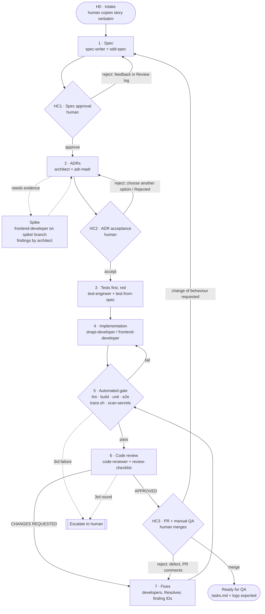

# FLOW — From functional user story to QA handoff

This document explains how a user story becomes a QA-ready increment in this repository: who
does what (AI agent or human), what each step produces, and where a person approves, rejects
or corrects the work.

The binding rules live in [CLAUDE.md](CLAUDE.md). The agent and skill catalogue is in
[AGENTS.md](AGENTS.md).

---

## 1. Design choices

### Tool: Claude Code

| Need | How Claude Code covers it |
|---|---|
| Subagents with separate responsibilities, versioned | `.claude/agents/*.md`: instructions, allowed and disallowed tools, model, preloaded skills, hooks |
| Reusable project knowledge, versioned | `.claude/skills/*/SKILL.md` with templates, loaded on demand |
| A global context file that governs generation | `CLAUDE.md`, loaded into every session and subagent |
| **Enforced** (not just requested) boundaries | `PreToolUse` hooks: per-agent write scopes, a project-wide Bash guard, and permission deny rules for `.env` |
| Unedited session logs | JSONL transcripts in `~/.claude/projects/…` plus `/export` |
| Git and GitHub from the same agent | Bash with `git` and `gh`, using a repo-local identity and credential helper |

Cursor, GitHub Copilot and Codex were alternatives. We did not run a feature-by-feature
verification of them, so we make no claims about what they lack. Claude Code was chosen because
it covers every row above in one tool, from versioned files, which we verified against its
official documentation. The deciding capability is **per-agent tool restrictions plus lifecycle
hooks**: they let a human *trust* the separation of responsibilities instead of hoping for it.

### Spec-Driven Development: our own lightweight variant

The spec is the source of truth. Tests are derived from it **before** the code, and the code
must make them pass. We did not adopt Spec Kit or Kiro, for three reasons:

- **Size.** Three stories do not justify their multi-phase scaffolding (constitution, plan and
  tasks generators).
- **Traceability.** We need IDs that run from the story to the PR (`US-01-AC-02`, …). With our
  own templates (`sdd-spec` skill), every artifact uses them and `scripts/trace.sh` can check
  them mechanically.
- **Gap detection.** The evaluation rewards specs that *detect gaps in the user story*, so our
  spec template has a first-class **Gaps and open questions** section, where each gap carries a
  proposed default and a human answer.

What we kept from SDD frameworks: spec → plan (ADRs + `tasks.md`) → tasks → implementation, with
a human approval between spec and implementation.

### Model allocation

| Role | Model | Why |
|---|---|---|
| Orchestrator (main session) | Claude Opus 5.5 | It holds the whole flow, talks to the human and routes the work |
| spec-writer, architect | Claude Opus 5.5 | Judgement-heavy work: finding gaps, weighing alternatives, verifying facts |
| test-engineer, strapi-developer, frontend-developer | Claude Sonnet 5.5 | Well-scoped work guided by an approved spec, ADRs and failing tests; faster and cheaper |
| code-reviewer | Claude Opus 5.5 | Deliberately a **different model from the implementers**, so the review does not share their blind spots |

---

## 2. Flow diagram



---

## 3. Step by step

| Step | Description | AI used? | AI, agent, subagent or skill used | Deliverable produced | Human in the loop |
|---|---|---|---|---|---|
| **0 · Flow setup** (once) | Repository, identity, agents, skills, hooks, scripts. Third-party skills are evaluated before adoption. | Yes | Claude Code, Opus 5.5 (main session) | `CLAUDE.md`, `AGENTS.md`, `FLOW.md`, `.claude/**`, `scripts/**`, `docs/skills/third-party-evaluation.md` | The human approves the proposal, each third-party skill (recorded decision) and the naming convention before anything is written. |
| **H0 · Intake** | The story is copied **verbatim** from the assessment, so the agents start from the real input and not from a paraphrase. | **No** by default. For US-01..03: **yes**, by human decision (see below) | Default: none. US-01..03: orchestrator (Opus 5.5) transcription + a deterministic word-by-word check against the PDF (`scripts/check-story-fidelity.py`) | `specs/US-NN/story.md` (with a provenance header: source, SHA-256, pages) | Default: the human writes it. US-01..03: the human delegated the transcription, and the fidelity check (0 differences) replaces the human copy. |
| **1 · Spec** | The story is turned into a verifiable spec. Rules are refined, gaps are listed with proposed defaults, ACs are written in Gherkin with IDs, and architectural decisions are flagged. | Yes | `spec-writer` (Opus 5.5) + skill `sdd-spec` | `specs/US-NN/spec.md`, `specs/US-NN/tasks.md` | — (next step is the gate) |
| **HC1 · Spec approval** | Nothing gets built on top of an unverified understanding. | **No** | — | Spec *Review log* row, *Human answer* cells, status `Approved` | **Human** answers the gaps and approves or rejects. **Approve if:** every BR is covered by an AC; every AC is testable with concrete values; every gap has an answer; scope and out-of-scope are explicit; no contradiction with accepted ADRs. **On rejection:** the feedback goes into the Review log and `spec-writer` revises it (same IDs, new version). |
| **2 · ADRs** | Decisions flagged by the spec are recorded with ≥2 real options and consequences. Library facts are verified against official sources or packages. When facts are not enough, a **spike** (30–60 min, throwaway branch) produces evidence. | Yes | `architect` (Opus 5.5) + skills `adr-madr`, `strapi-content-modeling`. Spikes: `frontend-developer` (Sonnet 5.5) | `adr/NNNN-*.md` (Proposed), `adr/README.md`, `docs/spikes/SPIKE-NN-*.md` | — (next step is the gate) |
| **HC2 · ADR acceptance** | Architecture is the most expensive thing to get wrong and the easiest for an agent to rationalise. | **No** | — | ADR status `Accepted` / `Rejected`, with *decision-makers* and date | **Human** reads the options and the strongest argument against the chosen one (the architect must state it). **Accept if:** the options are real, the drivers trace to requirements, the bad consequences have mitigations, and the facts are cited. **On rejection:** the human picks another option or marks it `Rejected` (the file is kept), and `architect` rewrites it. |
| **3 · Tests first** | Each AC becomes a test **before** the code exists, derived from the spec and not from an implementation. The tests must fail for the right reason. | Yes | `test-engineer` (Sonnet 5.5) + skills `test-from-spec`, `dynamic-form-fields` | `*.spec.ts`, `frontend/e2e/*.spec.ts`, `tasks.md` | Orchestrator check: `trace.sh` shows a test for every non-manual AC. No human gate here, because tests are reviewed again in step 6 and at HC3. |
| **4 · Implementation** | Production code that makes the tests pass, within the spec and ADRs. The write-scope hooks stop developers from editing tests or the spec. | Yes | `strapi-developer`, `frontend-developer` (Sonnet 5.5) + skills `strapi-content-modeling`, `dynamic-form-fields`, `angular-developer` (third-party, lower precedence) | `backend/**`, `frontend/**`, commits with `Refs:` | — |
| **5 · Automated gate** | Deterministic checks. Neither AI judgement nor human time is spent on what a script can verify. | **No** (scripts) | lint, `ng build`, Vitest, Playwright, `docker compose up`, `scripts/trace.sh`, `scripts/scan-secrets.sh` | Command output, summarised in `tasks.md` | **On failure:** back to step 4. **On the 3rd failure** of the same story: escalate to the human. |
| **6 · Code review** | An independent review against the spec, the ADRs and the checklist. The reviewer runs the checks itself and cannot modify code. | Yes | `code-reviewer` (Opus 5.5) + skill `review-checklist` | `reviews/US-NN-review-RN.md` (findings with IDs, severities, evidence) | — (findings are routed to step 7 or HC3) |
| **7 · Fixes** | Each finding is fixed in a commit that references it. The next review round verifies it. | Yes | `strapi-developer` / `frontend-developer`; `test-engineer` when a finding is a missing test | Commits with `Resolves: US-NN-RN-FNN`; updated status in the next review round | **On the 3rd review round** without approval: escalate to the human. |
| **HC3 · PR and manual QA** | The orchestrator opens the PR with the traceability matrix. A person checks what automation cannot: real keyboard use, visual quality, and copy in both countries. | Partly | Orchestrator opens the PR via `gh pr create`; merging is blocked for agents by a hook | GitHub PR (template + matrix), human review comments | **Human** reviews the PR and the review report, then runs the app for CO and CL, keyboard only, at mobile width. **Merge if:** the DoD (`CLAUDE.md` §12) holds and manual QA passes. **On rejection:** a defect (the app does not do what the spec says) becomes a finding and goes back to step 7; a change of behaviour (the human wants something the approved spec does not say) goes back to step 1, then the ADRs, tests and implementation, and the PR is reviewed again (US-04 had two such rounds). **Only the human merges.** |
| **8 · QA handoff** | State and evidence are left so that QA, or a fresh session, can pick up from the repository alone. | Yes | Orchestrator + skill `session-handoff` | `tasks.md` = `Ready for QA`, `logs/sessions/*` | The human runs `/export` (a CLI command the agent cannot run) and confirms the handoff. |

---

## 4. How control is enforced, not just requested

| Control | Mechanism | Where |
|---|---|---|
| Each agent writes only its own artifacts | `PreToolUse` hook on `Write\|Edit\|NotebookEdit` per agent (allow/deny globs, fails closed) | `.claude/agents/*.md` → `.claude/hooks/enforce-write-scope.mjs` |
| Developers cannot change tests; the tester cannot change code | Deny globs in the same hook | same |
| The reviewer cannot fix code | `Edit` disallowed; `Write` only to `reviews/US-NN-review-RN.md` | `.claude/agents/code-reviewer.md` |
| Delegation stays visible | `Agent` disallowed in every subagent (Claude Code would otherwise allow nesting up to 3 levels) | all agent files |
| Secrets are never read or printed | Permission deny `Read(**/.env)`, `Read(**/.env.*)` except `.env.example`; Bash guard blocks `.env` references and environment dumps | `.claude/settings.json`, `.claude/hooks/guard-bash.mjs` |
| Human checkpoints cannot be skipped by an agent | Bash guard blocks pushes to `main`, force pushes, `gh pr merge` and approvals, and `--no-verify` | `.claude/hooks/guard-bash.mjs` |
| Pinned toolchain | Bash guard blocks `@angular/cli@latest` and the Angular CLI MCP server | same |
| The story is traceable | `scripts/trace.sh` exits non-zero on untested ACs or open blocker/major findings | `scripts/trace.sh` |

### Known limits (accepted risks)

- **Bash can still write files.** The write-scope hooks cover the file tools, not `echo > file`
  inside Bash. Mitigation: the orchestrator checks `git diff --stat` after every subagent; the
  reviewer flags out-of-role changes; HC3.
- **The Bash guard matches patterns.** It catches mistakes, not deliberate obfuscation. The human
  checkpoints and GitHub branch protection (recommended for a team) remain the real controls.
- **Project hooks run only after the workspace trust dialog is accepted** in Claude Code.

---

## 5. Traceability

US → spec → ADR → commit → test → review → PR. The IDs and conventions are in `CLAUDE.md` §9–10.
Example of following one thread:

```
specs/US-01/spec.md#US-01-AC-02            what must happen
adr/0002-…md                               why it is built this way
git log --grep US-01-AC-02                 the commits that implemented it
frontend/**/…spec.ts › 'US-01-AC-02 …'     the test that proves it
reviews/US-01-review-R1.md                 what the reviewer found, and the Resolves: commits
PR #N                                      the matrix generated by scripts/trace.sh US-01
```

## 6. Resuming between sessions

The state lives only in the repository: `specs/US-NN/tasks.md` (*Current step*, *Next action*),
the specs, ADRs and reviews. The `session-handoff` skill defines the start and end procedures,
and the end procedure includes exporting the unedited session logs to `logs/sessions/`.

---

## 7. Reflection

### What we would do differently with a team of 5 developers

- **One owner per story, rotating approvers.** Each person takes one story through the whole flow;
  HC1 and HC2 are approved by someone else, so nobody approves their own spec or ADR.
- **Controls on the server, not on each machine.** Branch protection on `main` (required review and
  checks), CODEOWNERS for `CLAUDE.md`, `adr/` and `.claude/`, and the automated gate (lint, build,
  tests, traceability, secret scan) in CI. Local hooks become a convenience, not the control.
- **Isolation between people and agents.** Each one works in its own worktree, and only the story
  owner integrates into the story branch. With one developer we already had two collisions in the
  shared tree.
- **Shared, versioned contracts.** The Strapi content contract and the `FieldConfig` type become a
  package or a generated schema: with five people, frontend and backend drift faster than one
  orchestrator can catch.
- **Changes to the flow go through PRs.** Changing an agent, a skill or `CLAUDE.md` changes
  everybody's output, so it is reviewed like code.

### What did not work as expected, and how we adjusted

- **Approving UI on paper.** At US-04 HC1 the human chose "no input mask" for the date; in writing it
  looked right. At HC3, using the app, the human found defects that neither the gate nor the review
  had seen: the calendar opened above the field, a mistyped date showed the wrong message, and the
  name accepted digits. *Adjustment:* the feedback went through the full flow (spec v0.3, ADR-0014,
  tests, implementation, gate, review); for UI stories, HC1 is done on the running stack or a
  prototype.
- **Tests pushing the design.** Twice an agent changed the design so that a test would pass (US-03 and
  US-04). *Adjustment:* the human's rule: the approved design wins and the test adapts; the reviewer
  checks that no behaviour change was driven by a test.
- **Parallel agents in one environment.** In US-01 two agents polluted the shared stack; in US-04 an
  agent ran `git stash` on the shared tree and for a few minutes removed the others' uncommitted work
  (nothing was lost); and a gate run under load gave inconclusive results. *Adjustment:* agents run in
  parallel only when their files do not overlap, subagents run no git write commands, and the gate
  runs on a quiet machine.
- **Trusting "green" without verifying.** In US-01 the unit tests were green while the real browser
  failed; the orchestrator once truncated a control's output and reported a false "clean"; and US-04
  reached the 3-round review limit, mostly because of badly written e2e tests. *Adjustment:* a
  control's output is never truncated, e2e runs twice in a row on a clean stack, and at the limit the
  orchestrator stops and asks the human, as it did.

### Where we decided not to use AI, and why

| Point | Why not AI |
|---|---|
| HC1, HC2 and HC3 approvals, and the merge | Accountability: the person who signs off must be a person. Agents are technically blocked from merging, pushing to `main` and force-pushing. |
| Answers to the spec's gaps (`Q-NN`) | The AI proposes a default; the business decision is made by the person. |
| Story intake (H0) | The input must be the real requirement, not a paraphrase. **Exception:** US-01..03 were transcribed by the agent at the human's request, and a script compared them word by word with the PDF (0 differences). |
| Accepting third-party skills | A supply-chain trust decision. |
| Automated gate and traceability matrix | Deterministic checks are cheaper and more reliable than AI judgement, and cannot be talked out of a failure. The matrix is generated by `scripts/trace.sh`, so it cannot be invented. |
| Manual QA: keyboard, visual, screen reader and phone | Real interaction quality is what automation approximates worst; US-04 confirmed it. |
| Secrets and cleaning the git history | No agent reads `.env`. How to clean the history is the human's decision. |
| Exporting the logs (`/export`) | A CLI command run by the human; the agent only copies the raw JSONL, unedited. |
